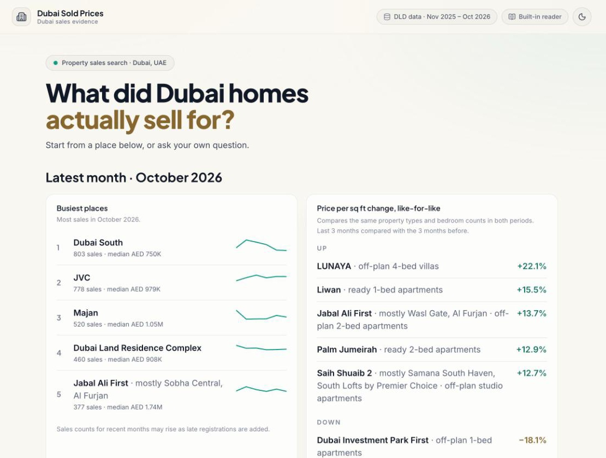
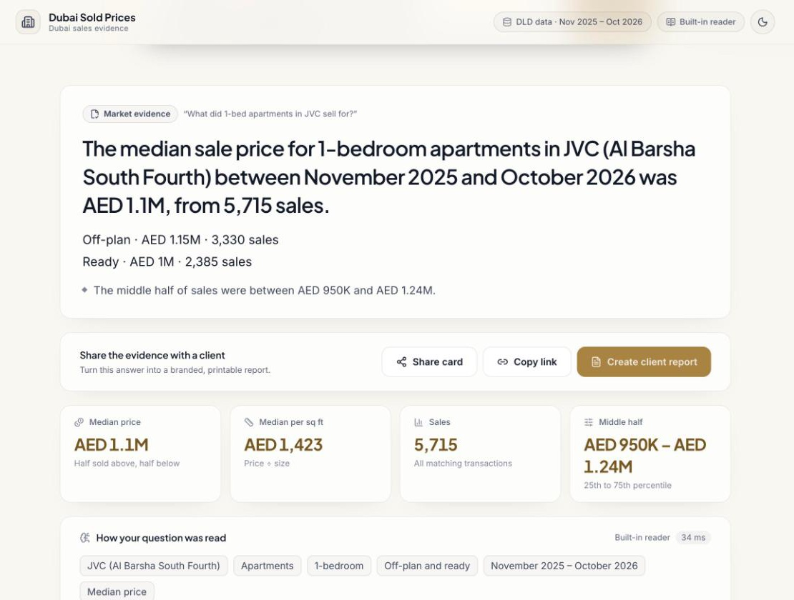
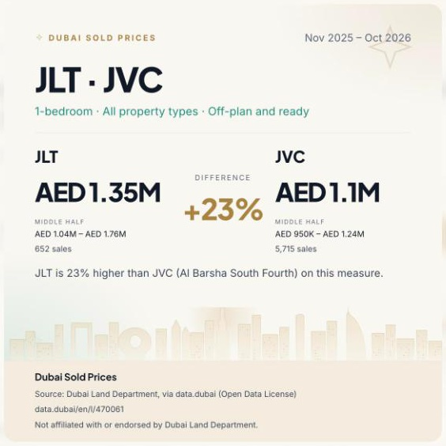
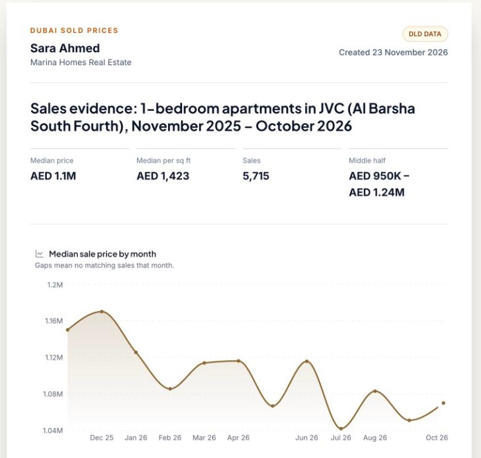

# Dubai Sold Prices

Ask what Dubai homes actually sold for, in plain English. Every answer comes from Dubai Land Department sales records: the median price, the middle range, the number of sales, a monthly chart and the sales behind it.



## Features

- **Plain-English questions.** "What did 1-bed apartments in JVC sell for?", "Compare JLT and JVC", "Villas in Arabian Ranches 3 last year". Nicknames like JVC, JLT and Downtown map to the official DLD area or community.
- **Evidence, not guesses.** The headline, median, middle half and sale count are calculated in code from matching sales, and each sale is listed below the answer.
- **Off-plan and ready shown separately,** so one median doesn't mix two different markets.
- **Latest month at a glance.** The busiest places, plus price-per-sq-ft changes that compare the same property types and bedroom counts in both periods. Sudden jumps from new project launches are listed apart from real price changes.
- **Built for agents.** A share card (square or story) for WhatsApp and Instagram, a printable client report, and a link that reopens the same answer.
- **Honest limits.** Sales only: it refuses rent, forecast and investment questions, warns when there are fewer than 10 sales, and says when it doesn't recognise a place instead of guessing.

| Answer | Share card | Client report |
|---|---|---|
|  |  |  |

## Run it

Requires Node 22 or newer.

```bash
npm install
npm run dev
```

Open http://localhost:5173. The API runs on port 8787, and Vite forwards `/api` calls to it.

Without any setup, the app runs on a **synthetic sample** of about 24,000 sales, so you can try it without downloading anything. To use the real data, see [Real DLD data](#real-dld-data).

| Command | What it does |
|---|---|
| `npm run dev` | Starts the web app and API together, reloading on changes |
| `npm test` | Runs the unit tests (Vitest) |
| `npm run eval` | Runs the question test set and saves a report in `evals/reports/` |
| `npm run build` | Type-checks and builds the web app into `dist/` |
| `npm run data:update` | Imports the newest DLD export, validates it and runs the tests |
| `npm run data:inspect` | Lists the columns and row counts of the raw DLD CSV files |
| `npm run data:import` | Imports the latest 12 complete months into `data/processed/sales.parquet` |
| `npm run data:validate` | Checks the imported data and compares app answers with direct DuckDB queries |

### Using Claude to read questions

By default, questions are read by a free, rule-based **built-in reader**. Claude handles wording the built-in reader can't:

1. Copy `.env.example` to `.env`.
2. Add your `ANTHROPIC_API_KEY`.
3. Restart `npm run dev`. The reader badge in the header changes from "Built-in reader" to "Claude".

Claude calls are billed by Anthropic. `DAILY_CLAUDE_CALL_LIMIT` (default 50) caps calls per day. If Claude fails or the limit is reached, the built-in reader answers instead and the page says so.

## How it works

```text
question ──► reader (Claude or built-in) ──► query plan ──► checked ──► SQL with placeholders ──► SQLite ──► statistics ──► answer
```

1. **Read the question.** The reader fills in a fixed **query plan**: places, property type, bedrooms, off-plan or ready, date range, measure and grouping. With Claude, the plan comes back as structured output that must match a Zod schema (`server/plan.ts`).
2. **Check the plan.** `validatePlan` rejects unknown places and fixes out-of-range dates, with a visible warning.
3. **Build safe SQL.** `compilePlan` uses fixed column names and a `?` placeholder for every value. **The AI never writes SQL.**
4. **Calculate.** Medians, percentiles and monthly series are computed in code (`server/aggregate.ts`), over every matching sale.
5. **Answer.** The sentence is written from those numbers by code (`server/answer.ts`), so it can't contain made-up figures.

## Project layout

```text
server/
  app.ts               Hono API: GET /api/meta, GET /api/snapshot, POST /api/ask (30 questions/min per visitor)
  ask.ts               the full pipeline, question to answer
  demoPlanner.ts       built-in rule-based reader
  claudePlanner.ts     Claude reader (structured outputs, prompt caching)
  plan.ts              query-plan schema, checks and the readable summary
  compile.ts           plan → parameterised SQL
  db.ts                SQLite in memory (sql.js), loaded from the sample or the DLD Parquet file
  aggregate.ts         medians, percentiles, monthly series
  answer.ts            plain-English answer from the numbers
  snapshot.ts          latest-month panel: busiest places, like-for-like changes, sales surges
  areas.ts             areas for the sample data
  communities.ts       communities such as JLT and Al Furjan, matched on DLD master projects
  areaAliases.json     nicknames for official DLD areas
  communityAliases.json  nicknames for DLD master projects
  dataMode.ts          sample or DLD mode, coverage and attribution
data/                  DLD import, inspection, validation and update scripts (DuckDB)
web/src/               React 19, Tailwind CSS 4 and Recharts, light and dark themes
  components/          answer, snapshot, share card, client report and the rest of the UI
tests/                 unit tests (Vitest)
evals/                 question test set and runner
```

## Design

- **Themes:** light (desert sand) and dark (Dubai at night), following the system setting until you choose one with the header toggle.
- **Accents:** gold and Gulf teal, a stylised Dubai skyline and a faint eight-point star pattern.
- **Mobile:** the main price shows first, and sales show as compact cards on phones and as a table on larger screens.
- **Accessibility:** `/` focuses the search, visible focus rings throughout, and reduced-motion support.

## Client report and share card

Any answer with matching sales can become a client report. Select **Create client report**, add an agent name and, optionally, an agency and a note, then preview it. Agent details stay in the browser's local storage and are never sent to the API.

The report includes the key figures, the monthly chart, ten recent comparable sales and the filters used. Use **Print / Save PDF** for an A4 copy, or copy a short summary for WhatsApp. Share-card images are made in the browser with `html-to-image`.

## Real DLD data

The data isn't included in this repository. To use it:

1. Download the Real Estate Transactions CSV export from [data.dubai](https://data.dubai/en/l/470061). It comes as one or more CSV files.
2. Put all the files from the newest export in `data/raw/`.
3. Run `npm run data:update`, then `DATA_MODE=dld npm run dev`.

The importer keeps the latest 12 complete months of residential sales and leaves out the current, incomplete month. It converts sizes from square metres to square feet, removes duplicate transactions and reports every row it drops, with the reason. Only the fields the app needs are kept, and none of them identify a person. The import stops if the CSV columns don't match `data/dldMapping.ts`.

Nicknames are in `server/areaAliases.json` and `server/communityAliases.json`. Each one must point to an area or master project that exists in the imported data.

`data/raw/` and `data/processed/` are ignored by Git, so the CSV and Parquet files are never committed.

## Deploying to Cloudflare (free plan)

The public demo runs as one Cloudflare Worker: the web app as static assets, the API in `worker/index.ts`, and the sales in Cloudflare D1. It's built to stay within the free plan:

- **Database reads** (5 million rows a day): the `sales` table is stored sorted by area and date, so a question about one area reads only that area. Dubai-wide questions, and answers over 25,000 sales, get a message asking for a narrower question instead. Answers are cached for a day.
- **Computing** (10 ms a request): `/api/meta` and the home-page snapshot are pre-built at deploy time.
- **Database writes** (100,000 rows a day): the data is split into files of at most 90,000 rows, loaded one a day.
- **Bots:** a [Cloudflare Turnstile](https://developers.cloudflare.com/turnstile/) check is required before the first question. A passed check is remembered for 12 hours in a signed cookie.

Local `npm run dev` has none of these limits.

```bash
npx wrangler login
npx wrangler d1 create dubai-sold-prices     # put the database_id in wrangler.jsonc
npm run d1:export                            # writes data/d1/*.sql
npx tsx data/d1Load.ts --remote 0-schema.sql 1-rows-01.sql   # day 1
npx tsx data/d1Load.ts --remote 1-rows-02.sql                # day 2
npx wrangler secret put TURNSTILE_SECRET_KEY # from the Turnstile widget
npm run cf:deploy
```

Set `TURNSTILE_SITE_KEY` under `vars` in `wrangler.jsonc`. To try the Worker locally, run `npm run d1:load:local` and `npm run cf:dev`, with Cloudflare's [Turnstile test keys](https://developers.cloudflare.com/turnstile/troubleshooting/testing/) in `.dev.vars`.

## Data licence and attribution

Source: Dubai Land Department, via [data.dubai](https://data.dubai/en/l/470061) (Open Data License).

This project is not affiliated with or endorsed by Dubai Land Department or the Dubai Government. Figures are for information only, not a valuation or financial or investment advice.

The application code is licensed under the [MIT License](LICENSE). The DLD data is licensed separately under the data.dubai Open Data License.

## Known limits

- The built-in reader handles common wording only. Its 100% test score comes from questions written alongside it, so treat it as a regression check, not proof of accuracy on new questions.
- It compares up to two places at a time, and can't compare property types or bedroom counts in one question yet.
- The public demo answers one area or community at a time, to stay within Cloudflare's free plan.
- Sales counts for the most recent months may rise as late registrations are added.
- The web bundle is about 500 KB, mostly the charting library, which could be code-split later.

## Author

Built by Ali Kalantari. Portfolio and contact: [thealik.com](https://thealik.com).
